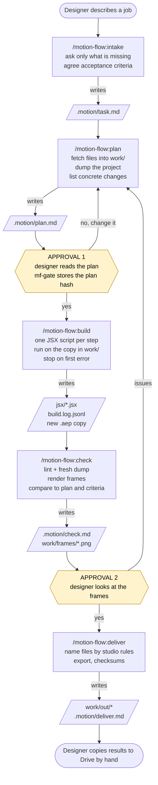
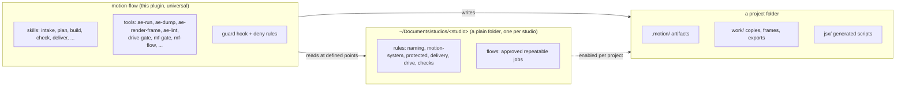
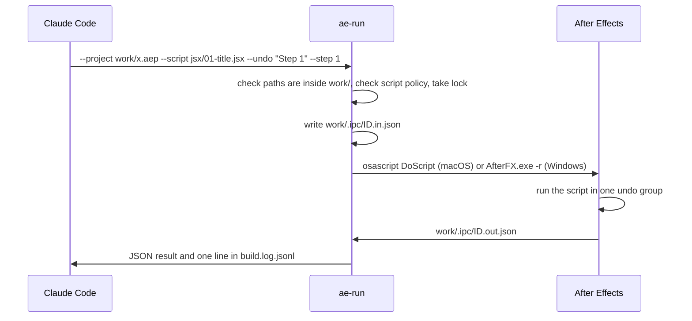
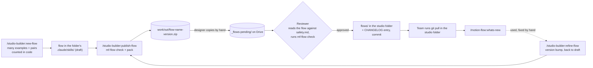

<p align="center">
  
</p>

# Motion Flow

A [Claude Code](https://claude.com/claude-code) plugin that gives a motion team an **agentic, gated pipeline for After Effects**. You describe a job in plain words; the agent plans it, you approve the plan, the agent builds it on a **copy** of your project, checks the result against the plan and the studio rules, you approve the check, and only then the final files are prepared.

- **Human in the loop, enforced in code.** Two approvals (after the plan and after the check) are real gates (`mf-gate`), not polite suggestions in a prompt.
- **Originals are never touched.** The agent works only on copies inside `work/`. Google Drive is read-only and reachable only through a small allowlisted tool (`drive-gate`). Nothing is written to Drive, nothing is deleted.
- **After Effects is driven by plain JSX scripts** run through one launcher (`ae-run`). No MCP server, no background service.
- **Studio rules live apart from the engine.** Naming, motion system, delivery formats and "do not touch" lists are a plain folder per studio (no plugin to install), so one engine serves many studios.
- **The studio teaches itself from examples.** A second plugin, `studio-builder`, reads as many example projects as you give it, counts the conventions in code, settles contradictions where the numbers decide, and writes the studio's design system and its flows. The pipeline uses the result; or you export a standalone `.claude/` and orchestrate it yourself.

> Status: milestones M0–M5 are implemented and covered by 400+ automated tests that need no After Effects. The parts that need a real After Effects (launching scripts, rendering frames) are written but still waiting for a manual check on a machine with AE. No license has been chosen yet. See [Status](#status).

## Contents

- [How it works](#how-it-works)
- [Requirements](#requirements)
- [Install](#install)
- [First-time setup (once per computer)](#first-time-setup-once-per-computer)
- [Start a project](#start-a-project)
- [Daily workflow](#daily-workflow)
- [Command reference](#command-reference)
- [Command-line tools](#command-line-tools)
- [Safety model](#safety-model)
- [Recommended folder structure](#recommended-folder-structure)
- [Studio builder](#studio-builder)
- [Troubleshooting](#troubleshooting)
- [Development](#development)
- [Status](#status)
- [Documentation and credits](#documentation-and-credits)

## How it works

Every task goes through five steps. Each step writes a file that the next one reads, so you can stop, close the terminal and continue tomorrow.



What stops the agent from skipping ahead: `build` refuses without an approved plan, and refuses again if `plan.md` changed after approval (the plan hash no longer matches). `deliver` refuses without an approved check. The agent cannot write the approval fields itself: approving always shows a Claude Code confirmation dialog. The one exception is **auto mode**, which the designer turns on explicitly (see [Run it in one command](#run-it-in-one-command)).

### Three layers



### How the agent talks to After Effects



## Requirements

| Needed | Why |
|---|---|
| Claude Code 2.1.295 or newer (CLI, desktop app or IDE extension) | Hosts the plugin. Older versions let a tool call through when the guard hook times out (`onFailure: block`). |
| Node.js 24 or newer | All plugin tools are Node scripts with no external packages. |
| Adobe After Effects (macOS or Windows) | Only needed to build and check. Planning, linting and the rest work without it. |
| ffmpeg 5 or newer | Probing and converting delivery files. |
| whisper.cpp (optional) | Only for flows that need transcripts. `doctor` recommends the biggest model that fits your RAM. |
| Google Drive for Desktop (optional) | Only if your sources live on Drive. Without it you copy files into `work/` yourself. |
| In After Effects: Settings → Scripting & Expressions → **Allow Scripts to Write Files and Access Network** | The scripts hand their result back through a file. |

`/motion-flow:doctor` checks all of this and prints the install command for your system. It installs nothing itself.

## Install

In Claude Code, add this repository as a plugin catalog and install the plugin:

```text
/plugin marketplace add GopkoDev/motion-flow
/plugin install motion-flow@motion
/plugin install studio-builder@motion
```

`motion-flow` is the pipeline. `studio-builder` is optional: it builds the studio's rules and flows from example projects (see [Studio builder](#studio-builder)). The two do not depend on each other; they share a few tools, so keep them at the same version (`doctor` warns when they differ).

Or from a terminal, scoped to a project so everyone on it gets the same version:

```bash
claude plugin marketplace add GopkoDev/motion-flow
claude plugin install motion-flow@motion --scope project
claude plugin install studio-builder@motion --scope project
```

Working from a local clone (for example while developing) works the same way, with a path instead of the GitHub name:

```bash
git clone https://github.com/GopkoDev/motion-flow.git ~/tools/motion-flow
claude plugin marketplace add ~/tools/motion-flow
claude plugin install motion-flow@motion --scope project
```

Scopes: use `project` for the shared setup, `local` for your own experiments, and studio rules are not plugins any more (see [Studio builder](#studio-builder)).

After installing, the tools in `bin/` (`mf-gate`, `ae-run`, ...) are on the `PATH` inside Claude Code sessions, and the slash commands appear as `/motion-flow:<name>` and `/studio-builder:<name>`.

## First-time setup (once per computer)

1. **Check the machine:** `/motion-flow:doctor`. Install what it lists as missing, then run it again.
2. **Turn on script file access in After Effects** (see the table above).
3. **Connect Google Drive (only if you use it):** `/motion-flow:setup`. It finds your Drive for Desktop folders, you pick which ones the agent may read, and it writes `~/.motion-flow/roots.json`. This file is your computer's catalog of Drive folders; each project later chooses which of them it may use.

If you do not use Drive, skip step 3. Everything works in no-Drive mode: you copy the source files into the project's `work/` folder.

## Run it in one command

After installing, open a terminal in a project folder outside Drive, start `claude`, and type:

```text
/motion-flow:go make a 9:16 version of the spring title, 12 seconds
```

The first time in a project, `go` asks three things once: **Google Drive** (none, or which folders), the **studio** (none, or one of the folders in your studios folder), and the **mode**. It sets the project up, remembers the answers, and runs intake, plan, build, check and deliver in a row. Next time you type `/motion-flow:go` it already knows the mode, Drive and rules, reads `mf-gate status`, and continues where the task stopped.

| Mode | What happens |
|---|---|
| ask | The agent asks what it needs and stops at the two approvals (after the plan and after the check). |
| auto | No questions and no approvals: the agent picks defaults (listed as assumptions in `task.md`), approves its own plan and check, and delivers. |

Auto mode is your decision, made once for the project: `mf-gate auto on` shows one Claude Code confirmation prompt. Everything else still applies: work on copies in `work/`, read-only Drive, the script policy, the build log, `mf-gate verify`. Auto approvals are recorded as `approved_by: auto`, and `mf-gate` refuses them (so a person must decide) when the plan touches protected items or the check found issues. To change the mode later, say so ("switch to ask mode") or run `mf-gate auto off`.

The sections below describe each step; you only need them to run a step by hand or to understand what the agent did.

## Start a project

Open a terminal in the project folder, start `claude`, and run:

```text
/motion-flow:init-project
```

`go` does this for you on the first run. Run `init-project` yourself to change the Drive or studio choice later, or to set up without `go`. It asks two questions, then creates the files:

1. **Does this project use Drive?** No Drive, or pick one or more of your Drive folders.
2. **Which studio's rules apply?** One studio, or none.

Created (nothing existing is overwritten):

| Path | Purpose |
|---|---|
| `.claude/settings.json` | Safety rules for this project (deny and ask lists), the plugin enabled for it, read access to your studios folder. |
| `.motion/studio.json` | Which studio's rules this project uses (by name). |
| `CLAUDE.md` | Short instructions for the agent. It tells the agent to answer you in Ukrainian. |
| `.gitignore` lines | Keeps `work/` and `.motion/state.json` out of git. |
| `.motion/state.json`, `.motion/drive.json` | Small state files (what you last read, which Drive folders this project may use). |
| `work/` | The only place the agent writes. |

If you picked a studio, the project may read (never edit) the studios folder. Run `/motion-flow:doctor` afterwards to confirm everything is green.

## Daily workflow

1. Put the source `.aep` and footage in `work/` (or tell the agent which Drive file to fetch).
2. Describe the job: `/motion-flow:intake` and then just talk ("make a 9:16 version of the spring title, 12 seconds").
3. Read the acceptance criteria the agent proposes (`AC1`, `AC2`, ...). They are the contract for the job.
4. `/motion-flow:plan` → read the plan table → approve or ask for changes. This is where you stop anything risky: the plan lists every target, the expected result and the frame the agent will check.
5. `/motion-flow:build` → the agent runs the plan step by step on a copy.
6. `/motion-flow:check` → look at the frames and the table. Approve, or send it back.
7. `/motion-flow:deliver` → copy the files listed in `.motion/deliver.md` to Drive yourself.
8. If you had to fix something by hand, run `/studio-builder:refine-flow` so the next run gets it right.

Each step ends with a short **handoff**: what was done, what to check, and the exact next command. You can `/clear` between steps; everything the next step needs is on disk in `.motion/`.

One task lives in `.motion/` at a time. To start another, the agent archives the finished one with `mf-gate archive` (it moves files to `.motion/archive/<id>/` and deletes nothing).

## Command reference

All commands are Claude Code skills, called as `/motion-flow:<name>`. You can also just describe what you want and the matching skill starts on its own.

### Setup commands

`go` is the shortcut for the five pipeline steps below (see [Run it in one command](#run-it-in-one-command)); the setup commands are needed only for the first run on a computer.

| Command | What it does | When to run it | Runs after / hands off to |
|---|---|---|---|
| `/motion-flow:doctor` | Checks Node, ffmpeg, After Effects, whisper, the Drive config, the project's safety settings, the project's studio folder (and which rules are still drafts) and plugin versions. Prints a table with install commands. Installs nothing. Can also ping After Effects with a real test script. | First thing on a new computer; whenever a step fails because "a tool is missing"; after updating plugins. | Standalone. Recommends `setup` or `init-project` when it finds them missing. |
| `/motion-flow:setup` | Finds your Google Drive for Desktop folders and records the ones you allow in `~/.motion-flow/roots.json`. The first write needs no questions; changing an existing file asks for confirmation. | Once per computer, only if you use Drive. Again when you add or change Drive folders. | After `doctor`. Hands off to `init-project`. |
| `/motion-flow:init-project` | Prepares the current folder as a motion project: safety settings, `CLAUDE.md`, `.gitignore` lines, `.motion/`, `work/`. Asks about Drive and about the studio rules. Safe to re-run to change those choices. | Once at the start of every project. | After `setup` (if Drive). Hands off to `intake`. |

### The five pipeline steps

| Command | What it does | Needs first | Writes | Hands off to |
|---|---|---|---|---|
| `/motion-flow:intake` | Understands the job, picks a studio flow if one fits (or offers `new-flow`), asks only the facts that are missing, and agrees the acceptance criteria. An independent sub-agent without chat history then looks for ambiguities, and `mf-gate verify task` checks the file. Changes no project. | A project initialised with `init-project`. | `.motion/task.md` | `plan` |
| `/motion-flow:plan` | Fetches the needed files into `work/` (through `drive-gate` if Drive is on), dumps the project with `ae-dump`, reads the studio rules, and writes a table of concrete steps: target, change, expected result, frame to check, which criteria it serves. Anything touching "protected" items is flagged. Then asks for your approval and stores the plan hash. | `task.md`. Refuses without it. | `.motion/plan.md`, `.motion/snapshots/` | **Approval 1**, then `build` |
| `/motion-flow:build` | For each plan step writes an idempotent JSX script in `jsx/`, runs it on the copy in `work/` through `ae-run` inside its own undo group, and logs the run. Stops at the first error, retries at most twice, then asks you. Works only on the copy the plan names (`project_copy`); running it again after an error continues on that same copy. | An approved plan whose hash still matches. Refuses otherwise. | `jsx/NN-*.jsx`, `.motion/build.log.jsonl`, a new `.aep` copy | `check` |
| `/motion-flow:check` | Runs `ae-lint` against the studio's checks, takes a fresh dump and compares it to the plan, renders the planned frames (plus first, last and mid-transition frames) with `ae-render-frame`, and traces **every acceptance criterion** to evidence (`PASS`, `FAIL`, `NOT_VERIFIED`). A separate read-only agent (`check-reviewer`) with a clean context, which never saw the build, re-checks the evidence from the files. It judges against the plan and rules, never taste. Then asks for your approval. | A clean `build.log.jsonl`. Refuses otherwise. | `.motion/check.md`, `work/frames/*.png` | **Approval 2**, then `deliver` (or back to `plan` on issues) |
| `/motion-flow:deliver` | Names the files by the studio rules, gathers them in `work/out/` with checksums, tells you what to copy to Drive and where, writes the changelog line. Asks whether to render video; today you export in After Effects into `work/out/` and it verifies the file. Optionally makes a local git commit of the text artifacts. Writes nothing to Drive. | An approved `check.md`. Refuses otherwise. | `work/out/*`, `.motion/deliver.md`, `.motion/changelog.md` | You (copy to Drive), then `refine-flow` if you fixed things by hand |

### Studio commands in motion-flow

Creating and improving flows is done by the `studio-builder` plugin (see [Studio builder](#studio-builder)). motion-flow only reads what it builds:

| Command | What it does | When to run it | Hands off to |
|---|---|---|---|
| `/motion-flow:whats-new` | Shows, in one sentence each, what changed in the studio rules and flows since you last looked (reads the rules' `CHANGELOG.md`, remembers what you saw in `.motion/state.json`). | After the studio rules plugin was updated. | Standalone |

## Command-line tools

The skills call these tools for you; you rarely type them. They are on the `PATH` while the plugin is enabled. Every tool prints JSON (or a readable table for `mf-doctor`) and exits non-zero on failure.

| Tool | Purpose | Called by / when |
|---|---|---|
| `mf-doctor` | The engine behind `doctor`. `--ping-ae` runs a real script in After Effects. | `doctor` |
| `mf-setup` | Detects Drive folders (`--detect`), validates a choice (`--dry-run`), writes `~/.motion-flow/roots.json`, shows it (`--show`). | `setup`, `init-project` |
| `mf-init` | Creates the project files. `--dry-run` previews; `--drive a,b` or `--no-drive`; `--studio <name>` or `--no-studio`; `--update-permissions` adds the allow rules to an older `settings.json`. Never overwrites. | `init-project` |
| `mf-gate` | Pipeline gates: `require <step>`, `hash plan`, `approve <plan\|check> [--auto]`, `auto <on\|off\|status>`, `status`, `verify <task\|plan\|check>`, `archive [--abandon\|--park]`, `restore`. | Every pipeline skill |
| `drive-gate` | Read-only Drive access: `ls`, `info`, `fetch` (copies into `work/`, can bring a project's linked files), `log`. No write, move or delete commands exist. | `plan`, `learn-studio`, `new-flow` |
| `ae-run` | The only way to run JSX in After Effects. `--ping`; `--project`, `--script`, `--undo`, `--step`, `--timeout`, `--params`. Writes the build log. | `build`, `doctor` |
| `ae-dump` | Reads a project into JSON (comps, layers, keyframes, expressions, fonts, footage). Never changes the project. | `plan`, `check`, `sb-corpus` |
| `ae-render-frame` | Renders one frame of a comp to PNG at a given time. | `check` |
| `ae-lint` | Runs the studio's declarative checks on a dump (fps, size, names, missing media/fonts, default layer names, protected items). | `check` |
| `aep-version` | Computes the next version name (`spring_v07.aep` → `spring_v08.aep`) without overwriting. | `build`, `deliver` |
| `mf-studio` | Finds studio rules in the studios folder: `list`, `dir`, `path` (where the project's studio rules are). | `go`, `init-project`, every step that reads rules |
| `mf-sheet` | Puts the check frames into one numbered contact sheet with ffmpeg (up to 12 per sheet), so `check` reads one image instead of 12-20. | `check` |
| `mf-sum` | SHA-256 checksums for delivered files. | `deliver` |
| `mf-whatsnew` | Reads a rules changelog and what you already saw. | `whats-new` |

## Safety model

| Layer | What it enforces |
|---|---|
| Skills | Work on copies in `work/`, one undo group per change, stop and ask at any surprise, never install anything, approvals only after an explicit human answer. |
| `mf-gate` | The step order and the plan hash, as code. A changed plan needs a new approval. |
| `ae-run` | Paths only inside `work/`, one run at a time (lock file), a script policy that rejects agent scripts using system calls, `eval`, raw `File`/`Folder`, quitting AE, and similar. Scripts cannot raise dialogs. |
| `drive-gate` | Every path is resolved with `realpath` and must stay inside an allowed Drive folder. No writes, deletes, moves or renames exist. Every call is logged to `~/.motion-flow/drive-gate.log`. |
| `guard` hook | Blocks direct access to Drive folders and to `~/.motion-flow/`, `rm`/`mv` outside `work/`, direct launches of After Effects, and manual writes to the approval fields and the build log. Dangerous git (`push`, `reset --hard`, `clean -f`, `checkout -f`) and deletes inside `work/` ask for your confirmation instead of failing. |
| Project `permissions` | The same Drive and config paths in `deny`, dangerous git in `ask`, as a second line of defence. |

Inside a project, `init-project` sets `defaultMode: acceptEdits` and allows the plugin tools (`mf-gate`, `ae-run`, `ae-dump`, ...), so writing `task.md`, `plan.md`, `jsx/*.jsx` and running a build do not ask for confirmation. The guard hook runs before these allow rules and still wins, so the approvals and the other risky actions below keep asking. A project created before v0.1.1 gets the same settings with `mf-init --update-permissions` (`doctor` tells you when it is needed).

Remaining permission prompts come from these rules. Read the path or command in the prompt; approve only if it is what you expect.

Data privacy: the agent reads your projects and the files in `work/`, and that content goes to the model provider through Claude Code. Do not use this on material you are not allowed to send to an AI service.

## Recommended folder structure

Keep three things separate: the plugin engine (installed once, you never edit it), the rules of each studio (one folder per studio), and your projects.

```text
~/Documents/studios/                    # one folder per studio you work for (outside Drive)
  acme/                                 # acme's rules: a plain folder, own git repo if you like
    INDEX.md
    rules/  naming.md motion-system.md protected.md delivery.md drive.md
            project-template/  checks/
    flows/                              # approved flows
    CHANGELOG.md
  nova/                                 # another studio, kept separate

~/Projects/                             # your projects, outside Drive
  acme-spring-campaign/                 # open your terminal and run claude HERE
    .claude/settings.json               # safety rules, plugin and studio access for this project
    CLAUDE.md
    .motion/                            # task.md plan.md check.md deliver.md,
      snapshots/  archive/  state.json  #   dumps, archived tasks, small state
      build.log.jsonl  changelog.md
      studio.json  drive.json          #   the studio and Drive chosen for this project
    jsx/                                # generated scripts (commit them if you use git)
    work/                               # gitignored: copies, frames, exports
      spring_v07.aep   frames/   out/   .ipc/

~/Google Drive/...                      # untouched originals; read through drive-gate only
```

Tips for a comfortable setup:

- **One project folder per job**, one terminal per project. The agent only ever sees that folder.
- **Keep project folders outside Google Drive.** Drive's streaming and sync fight with a tool that writes many small files. `init-project` refuses to run inside a Drive folder for this reason.
- **Keep studio rules in their own git repo** (for example `~/Documents/studios/acme`) so changes are reviewed and versioned. There is nothing to install: a teammate clones the repository into their studios folder, and updates are a `git pull`. Keep the studios folder outside Drive. `~/.motion-flow/studios.json` with `{"dir": "<path>"}` moves it.
- **One studio per project.** If you freelance for several studios, keep one folder per studio and choose exactly one in each project. `go` and `init-project` list the folders they find, so a studio you have just created is selectable at once.
- **Treat `work/` as disposable.** Anything that matters is either an original on Drive or a file you copied out of `work/out/`. After a task, `mf-gate archive` keeps its paperwork under `.motion/archive/`.
- **Git is optional.** Use it for the plugin and the studio folders. In a project, commit only text (`.motion/`, `jsx/`); never `.aep`, footage or renders.
- **Handy habit:** run `/motion-flow:doctor` at the start of the day on a new machine, and `/clear` between pipeline steps to keep the chat light.

## Studio builder

`studio-builder` is a separate, optional plugin. It turns example projects into the studio's **design system** (naming, motion system, protected items, delivery, Drive layout) and **flows** (repeatable jobs), as plain files in a folder per studio: `~/Documents/studios/<studio>/`. The pipeline reads that folder; nothing is installed per studio.

### Why many examples

The old way read one or two projects and then interviewed you. The builder takes **every project you give it**, because a count of 45 of 50 is evidence and one project is a guess:

1. Put the examples in `work/examples/` (one sub-folder per client or campaign if you can), or point it at Drive folders. Old, ugly and mixed projects are welcome: the counts need the real mix.
2. `sb-corpus dump` opens each project in After Effects, one at a time, and reads its structure. It switches projects by itself when the open one is saved and unchanged, and stops (never closes) when it has unsaved changes. Dumps are reused, so an interrupted run continues.
3. `sb-corpus analyze` counts, in code: frame rate, sizes, name patterns, fonts, effects, easing, default layer names, expressions. The agent reads a short report, not 50 dumps.
4. **Contradictions are settled where the numbers decide.** A convention used by 80% of the projects is the rule. A value that only older projects use is a legacy shift (the studio moved on). A value that follows the client folder is a rule per client. Only a real tie, or no majority, becomes a question for you, and all such questions come together with the counts and a recommended answer.
5. Everything is written as `status: draft` with the support ("45 of 50 projects"). A person confirms each rule; the agent never does.

### Commands

| Command | What it does |
|---|---|
| `/studio-builder:learn-studio` | Builds the design system from the examples, as described above. Run it in `~/Documents/studios/<studio>`. Run it again when more examples arrive. |
| `/studio-builder:new-flow` | Learns a repeatable job from before/after pairs and successive versions (`spring_v07` → `spring_v08`, or `before.aep` / `after.aep` in one folder). `sb-corpus` counts which changes repeat; you sort them into "part of the flow", "incidental" and "wrong"; the draft is checked step by step against the evidence. |
| `/studio-builder:refine-flow` | After a delivery, compares the result with what you fixed by hand, proposes a change ("always, or only here?"), bumps the version and sets the flow back to `draft`. |
| `/studio-builder:publish-flow` | Checks the flow (`mf-flow check`), reads it against the safety rules and packs it into `work/out/flow-<name>-<version>.zip` for the reviewer. |
| `/studio-builder:export-claude` | Exports the design system and the flows as a standalone `.claude/` (a `CLAUDE.md`, `.claude/rules/design-system/`, one skill per flow) in a folder you choose, so you can orchestrate without the five-step pipeline. Re-running it refreshes the studio's files and keeps the ones you edited. |

Tools: `sb-corpus` (dump, analyze), `sb-export`, `sb-init`, `mf-flow` (check, bump, pack), and the shared `ae-dump`, `ae-run`, `drive-gate`, `mf-studio`.

### Where the studio's files live

The rules of a studio are a plain folder, created once from a scaffold shipped in this repo (`plugins/studio-builder/templates/studio-rules/`):

1. Create `~/Documents/studios/<slug>` (a short lowercase name such as `acme`), `git init` it if you want to share it, and open Claude Code there.
2. Run `/studio-builder:learn-studio`. It copies the scaffold, then builds the drafts from your examples.
3. A person reads each rule, fixes it, sets `status: confirmed` and commits. Until then, steps warn that they are reading a `draft`.
4. Every project picks the studio by name, once, in `go` (first run) or `init-project`. The team clones the same folder into their own studios folder.

How a flow gets from one designer to the whole team:



## Troubleshooting

| Symptom | Likely cause and fix |
|---|---|
| A step answers "refused: plan_not_approved" or "plan_changed_after_approval" | That is the gate working. Approve the plan again, or run `plan` to change it. |
| `build` refuses with `build_failed` / `check` refuses | The log has an error. Read `.motion/build.log.jsonl`, fix the cause, rebuild. |
| "No Drive folders are set up on this computer" | Fine without Drive. Otherwise run `/motion-flow:setup`. |
| "Another project is open in After Effects" | That project has unsaved changes (or was never saved). Save and close it. The tools switch projects by themselves only when the open one is saved and unchanged, so your work is never lost. |
| `ae-run --ping` times out | Check that After Effects is installed, that the script-access setting is on, and that no modal dialog is open in AE. |
| A permission prompt appears for `rm`, `git push`, a Drive path | Intended. Read it and approve only if you expect it. A direct Drive path or a launch of AE outside the tools is blocked outright. |
| `project settings.json not found` in `doctor` | Run `/motion-flow:init-project` in the project folder. |
| `doctor` says the project's studio folder is missing | The project names a studio that is not in the studios folder (`mf-studio dir`). Put the folder there, or choose another studio with `init-project`. |

## Development

The repository holds two plugins and one catalog:

```text
.claude-plugin/marketplace.json   the catalog ("motion"): motion-flow and studio-builder
plugins/motion-flow/              the pipeline: intake, plan, build, check, deliver
plugins/studio-builder/           builds a studio's rules and flows from example projects
shared/                           code both plugins need (After Effects and Drive tools, guard hook)
scripts/                          repository checks: sync-shared, language, catalog
```

A plugin is installed on its own, so it cannot read a sibling folder. Code that both need lives once in `shared/` and is **copied** into each plugin (the copies are committed, listed in each plugin's `.shared.json`). Edit the file in `shared/`, then run `npm run sync`; `npm test` fails if a copy differs from its source. Both plugins are released together with the same version.

```bash
npm run sync                          # copy shared/ into the plugins after editing it
npm test                              # sync check + all unit tests (node:test), no After Effects needed
node plugins/motion-flow/scripts/validate_plugin.mjs plugins/motion-flow   # structural validator for a plugin
claude plugin validate plugins/motion-flow/.claude-plugin/plugin.json
node plugins/motion-flow/scripts/check_jsx.mjs [--policy] <folder>         # ES3 / script-policy check for JSX
```

Rules for contributing:

- Everything in the repository is **English**: code, skills, templates, docs, tool messages. Ukrainian appears only in the chat with the designer, produced by the agent at run time. `scripts/language.test.mjs` enforces this.
- Node.js ESM (`.mjs`), no external dependencies, tests with `node:test`.
- After Effects is driven by JSX through `ae-run` only; Drive is read-only through `drive-gate`.
- Read the reference repos for a task before writing it (ideas in your own words, check their licenses, never copy code).

## Status

| Milestone | State |
|---|---|
| M0 skeleton, M1 safety and Drive, M2 running JSX in AE, M3 five steps, M4 studio rules, M5 flows | Implemented and tested without After Effects. |
| M3a acceptance criteria, independent pass, `mf-gate verify` | Done; `intake` also takes a reference image as direction. Motion-quality lint warnings, `matchName` dump keys, a pitfalls library, destructive-step markers and better question wording in `intake` are planned. |
| Manual checks on a machine with After Effects (T2.9, T3.9, T4.4, T5.5) | Pending. Launching scripts, rendering frames, BOM/UTF-8 handling and Windows paths are not yet verified on real AE. |
| M6 evals, pilot | Planned. |
| `ae-export` (automatic video export) | Not built; for now you export from AE into `work/out/`. |
| License | Not chosen yet. |

The full task list with acceptance criteria is in [`docs/TASKS.md`](docs/TASKS.md).

## Documentation and credits

- [`docs/motion-flow-spec.md`](docs/motion-flow-spec.md): the full specification, including section 16 with the decisions made during development.
- [`docs/TASKS.md`](docs/TASKS.md): milestones and tasks.
- [`docs/schemas-notes.md`](docs/schemas-notes.md): notes on the Claude Code plugin, marketplace, hooks and settings schemas, checked against the docs.
- [`NOTICE`](NOTICE): attribution.
